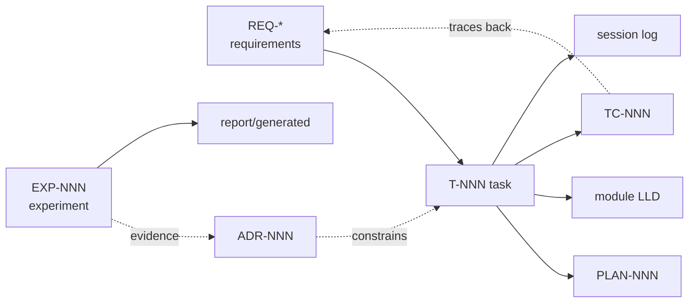

# NNP Documentation

The single home for everything needed to understand, continue, defend and maintain NNP.

## Map

| Folder | Holds | Index |
|---|---|---|
| `architecture/` | High-level design: pipeline, module map, artefacts, resources, limitations | [HLD.md](architecture/HLD.md) |
| `modules/<name>/` | Low-level design per module (how it's built) | [modules/README.md](modules/README.md) |
| `decisions/` | Architecture Decision Records (`ADR-NNN`): what we decided and why | [decisions/README.md](decisions/README.md) |
| `tasks/` | Task specs + status (`T-NNN`). **Source of truth for status.** Each has "Explain it" for the oral discussion | [tasks/README.md](tasks/README.md) |
| `implementationPlans/` | Step-by-step plan per task (`PLAN-NNN`) | [implementationPlans/README.md](implementationPlans/README.md) |
| `experiments/` | Experiment records (`EXP-NNN`): question → setup → result → decision | [experiments/README.md](experiments/README.md) |
| `TCs/` | Acceptance test cases (`TC-NNN`) traced to the brief | [TCs/README.md](TCs/README.md) |
| `SystemGuides/` | How-to guides (`SG-NNN`): setup, workflow, reproduce, HF deploy, submission | [SystemGuides/README.md](SystemGuides/README.md) |
| `RefrenceDocs/` | The brief, extracted requirements (`REQ-*`), literature notes | [RefrenceDocs/README.md](RefrenceDocs/README.md) |
| `sessions/` | Session logs and handoffs (`YYYY-MM-DD-SNNN-slug.md`) | [sessions/README.md](sessions/README.md) |

## How the pieces connect

## Studying for the oral discussion
Read, in order: [HLD](architecture/HLD.md) → [EXP-001](experiments/EXP-001-shift-diagnosis.md) → ADR-003/004/006/007 → every task's **Explain it** section → the module doc of your phase.

## Conventions
See [../CLAUDE.md](../CLAUDE.md).
